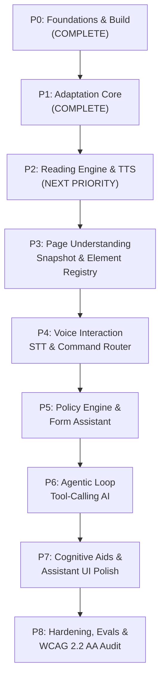

# Implementation Plan: Tederash Universal Web Accessibility Extension

## Executive Summary

The standalone extension repository (`../Tederash`) has been successfully integrated into the `tederash-ui-library` monorepo at [`extension/`](./extension) as a first-class workspace package alongside `@tederash/core`, `@tederash/react`, `@tederash/components`, `@tederash/assistance`, and `apps/docs`.

All 23 extension unit tests pass, all 282 core SDK tests pass, and the dual build pipeline (Next.js static export + esbuild MV3 service worker/content/offscreen bundles) is verified and working.

This plan aligns the ongoing development of the extension with [`extension/AGENTS.md`](./extension/AGENTS.md), establishing milestones from current foundations through the autonomous agent loop and WCAG 2.2 AA certification.

---

## 1. Current State Assessment

### 1.1 What Has Been Completed & Verified

| Component | Status | Details |
|---|---|---|
| **Monorepo Integration** | **DONE** | Added to `pnpm-workspace.yaml`, aligned Vitest 2.1.9, resolved React 18/19 JSX compatibility in `extension/pages/_app.tsx`. |
| **P0 Build Pipeline** | **DONE** | Next.js static export (`out/next/`), postbuild CSP verification (0 inline scripts), esbuild bundling of `background.js`, `content.js`, `offscreen.js`, and `main-world.js`, manifest generator. |
| **P0 Messaging & Storage** | **DONE** | Typed versioned envelopes (`extension/src/shared/envelope.ts`), Zod-validated message contracts (`extension/src/shared/messages.ts`), `StorageService` with schema migrations. |
| **P1 Adaptation Engine** | **DONE** | Reversible CSS injection (`extension/src/extension/content/adapt/engine.ts`), Mutation Ledger (`extension/src/extension/content/adapt/ledger.ts`), resolution hierarchy (Defaults → Global → Profile → Site → Session). |
| **UI Surfaces** | **DONE** | Popup (`PopupView.tsx`), Onboarding 6-step flow (`onboarding.tsx`), Options Dashboard 8-tab shell (`options.tsx`), Side Panel shell (`sidepanel.tsx`). |

---

## 2. Updated Implementation Roadmap

### Phase P2 — Reading Engine & Speech Synthesis (Immediate Next Phase)

**Goal:** Provide responsive, distraction-free reading of web content with synchronized speech and highlights.

1. **Reading-Order Model** (`src/extension/content/reading/order.ts`):
   - Traverse DOM to extract coherent text segments starting from `<main>` and `<article>` landmarks.
   - Filter out repetitive headers, footers, ad blocks, and navigation elements.
   - Retain DOM `Range` mappings for each segment for real-time visual tracking.
2. **Text-to-Speech Queue** (`src/extension/background/tts/`):
   - Implement `chrome.tts` controller in service worker with priority queuing (*interrupt* > *feedback* > *reading*).
   - Capture `onEvent` word boundary callbacks to broadcast character offsets to content scripts.
3. **Synchronized Highlights** (`src/extension/content/reading/highlight.ts`):
   - Utilize CSS Custom Highlight API (`CSS.highlights`) when supported (zero DOM mutation).
   - Fallback to overlay highlight rectangles in content script.
4. **Reading Ruler / Line Focus** (`src/extension/content/reading/ruler.ts`):
   - Inject pointer-events-none ruler into Shadow DOM overlay following mouse or reading position.
5. **Keyboard Shortcuts & Controls**:
   - Wire `Alt+Shift+R` to trigger reading, `Alt+Shift+S` to stop speech instantly (< 200ms latency).

---

### Phase P3 — Page Understanding Layer (Deterministic Foundation)

**Goal:** Provide semantic DOM awareness without requiring an LLM.

1. **Element Registry & Fingerprints** (`src/extension/content/registry.ts`):
   - Stable references (`e1`, `e2`, ...) mapped to `WeakRef<Element>`.
   - Fingerprinting: `{ role, name, tag, landmarkPath, textHash, attrsHash }` for resilient re-resolution after dynamic DOM updates.
2. **Snapshot Builder** (`src/extension/content/snapshot/`):
   - Implement snapshot modes: `interactive` (clickable elements, form controls, headings), `content` (reading chunks), `form` (`FormSchema`).
   - Standard accname computation with `dom-accessibility-api` and role inference with `aria-query`.
   - Heuristic role detection for div/span buttons (`cursor:pointer`, `tabindex`, onclick handlers).
   - Sensitive field classification (password, card, CVV, OTP).
3. **Shadow DOM & Cross-Frame Coordinator** (`src/extension/background/frames/coordinator.ts`):
   - Traverse open and closed Shadow DOM (`chrome.dom.openOrClosedShadowRoot`).
   - Coordinate snapshots across iframes with namespaced element refs (`f1:e4`).
4. **Deterministic Action Executors** (`src/extension/content/actions/`):
   - `click`: Occlusion checking via `elementFromPoint`, realistic mouse/pointer event dispatch with `el.click()` fallback.
   - `fill`: Native value setter manipulation (`HTMLInputElement.prototype.value`) + `input` and `change` event dispatch for React/Vue form binding.
   - `select`, `check`, `scroll`, and `wait_for`.

---

### Phase P4 — Voice Interaction & Command Router

**Goal:** Natural hands-free operation across browser tabs.

1. **Offscreen Speech Recognition** (`src/extension/offscreen/`):
   - `webkitSpeechRecognition` running in offscreen document (`USER_MEDIA`).
   - Stream `interim` and `final` transcripts to service worker via message port.
2. **One-Time Mic Permission Flow**:
   - Permission request flow from extension page (onboarding / options) via `getUserMedia`.
3. **Deterministic Command Router** (`src/extension/background/router/`):
   - Grammar parsing + fuzzy matching (`fuse.js`):
     - Reading: *"read this page"*, *"pause"*, *"faster"*, *"next section"*.
     - Navigation: *"scroll down"*, *"go back"*, *"scroll to main"*.
     - Interaction: *"click login"*, *"click 12"*, *"select standard shipping"*.
     - Adaptation: *"larger text"*, *"dark mode"*, *"turn on ruler"*.
4. **Disambiguation & Mode Management**:
   - Command Mode vs. Dictation Mode toggle.
   - Numbered visual badges for multiple matching targets ("Which one: 1 or 2?").

---

### Phase P5 — Deterministic Policy Engine & Form Assistance

**Goal:** Secure, guided form completion with strict execution safeguards.

1. **Policy Engine** (`src/extension/background/policy/`):
   - Classify all actions into risk tiers: `none`, `low`, `consequential`, `destructive`, `blocked`.
   - Hard blocks: never solve CAPTCHAs, never allow external model to inject credentials or payment data.
   - Consequential / Destructive gate: require DOM-derived user confirmation with single-use `confirmationToken`.
2. **Form Detection & Schema Builder** (`src/extension/content/forms/`):
   - Detect forms, field types, validation constraints, and logical groupings.
3. **Guided Form Step-Through Wizard**:
   - Field explanation in plain language.
   - Local Vault matching (`name`, `email`, `phone`, `address`) without exposing raw values to cloud LLMs.
   - HTML5 and ARIA validation verification.

---

### Phase P6 — Agent Loop (Tool-Calling LLM Orchestration)

**Goal:** Autonomous goal execution on unfamiliar or poorly built websites.

1. **Provider Abstraction** (`src/extension/background/llm/`):
   - Pluggable `LlmProvider` supporting Anthropic, OpenAI, Chrome Built-in AI, and custom proxy.
2. **Observe → Plan → Act → Verify Loop** (`src/extension/background/agent/`):
   - Observation delta compression (minimizing tokens).
   - Checkpoint state to `chrome.storage.session` to survive Service Worker termination.
   - Loop guards (oscillation detection, step budgets max 12 steps).
3. **Prompt Injection & Data Defenses**:
   - Spotlighting: page text wrapped in `<page_data untrusted="true">`.
   - Data redaction pass before LLM dispatch (masking passwords, cards, PII).
4. **Agent Activity Log**:
   - Visible, user-auditable ledger of every tool call and payload.

---

### Phase P7 & P8 — Polish, Ethiopian Localization & Hardening

1. **Ethiopian Context Integration**:
   - Bridge `@tederash/core` Amharic dictionaries and Ge'ez typography into extension popup and content adaptations.
   - Amharic TTS/STT language tagging (`am-ET`).
2. **WCAG 2.2 AA Automated & Manual Audit**:
   - CI axe-core checks on popup, options dashboard, onboarding, and floating assistant.
   - Keyboard-only navigation pass with visible 3px focus rings and ≥44px touch targets.
