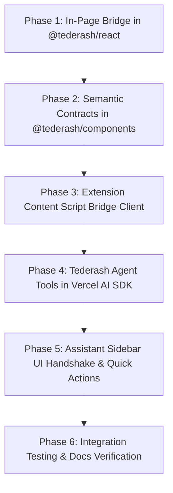

# Tederash Ecosystem Bridge: Scalable Implementation Plan

**Objective**: Establish a scalable, deterministic, and type-safe integration bridge between the **Tederash Component Library** (`@tederash/react`, `@tederash/components`) and the **Tederash Browser Extension AI Assistant**.

---

## 1. Architectural Strategy & Design Principles

### Why a Deterministic Bridge?
Generic AI browser agents attempt to parse arbitrary HTML through heuristics, coordinate clicking, and brute-force CSS manipulation. This results in brittle execution, communication disconnects on restricted pages, and high error rates.

By establishing a **first-class protocol between the UI Library and the Extension**, Tederash achieves:
1. **Sub-millisecond Detection**: Zero-latency verification of whether the active page is a Tederash app.
2. **Rich Semantic Perception**: The agent reads structured component state (active profile, validation errors, field guidelines, dialog states) directly from the React runtime rather than guessing from HTML tags.
3. **Reactive Adaptations**: Adjustments (`fontScale`, `contrastTheme`, `targetSize`, `locale`) update React state reactively via the framework runtime, completely preventing broken page layouts.
4. **Type-Safe Contract**: Shared TypeScript schemas ensure backwards compatibility as the component library and extension evolve.

```
┌────────────────────────────────────────────────────────────────────────┐
│                   Active Browser Tab (Web Application)                 │
│                                                                        │
│   ┌────────────────────────────────────────────────────────────────┐   │
│   │  Tederash React App (Window / Page World)                      │   │
│   │   • <AccessibilityProvider> (Runtime, Profile, Locale)         │   │
│   │   • <AccessibleForm>, <AccessibleInput>, <AccessibleButton>    │   │
│   │   • In-Page Bridge (window.__TEDERASH__ & CustomEvent Bus)     │   │
│   └──────────────────────┬──────────────────────▲──────────────────┘   │
│                          │                      │                      │
│                  CustomEvent:            CustomEvent:                  │
│               'tederash:response'     'tederash:request'               │
│                          │                      │                      │
│   ┌──────────────────────▼──────────────────────┴──────────────────┐   │
│   │  Tederash Extension Content Script (Isolated World)            │   │
│   │   • Handshake Detector (<html data-tederash-root>)             │   │
│   │   • Bridge Client (dispatches semantic requests)               │   │
│   │   • Semantic Snapshot Builder                                  │   │
│   └──────────────────────┬──────────────────────▲──────────────────┘   │
└──────────────────────────┼──────────────────────┼──────────────────────┘
                           │ Chrome Runtime       │ Chrome Tabs
                           │ sendMessage          │ sendMessage
┌──────────────────────────▼──────────────────────┴──────────────────────┐
│  Tederash Background Service Worker & Assistant Sidebar                │
│   • Vercel AI SDK Agent Runner (Groq Llama / GPT-OSS Reasoning)        │
│   • Tederash Toolset: tederash_detect, tederash_get_tree,              │
│     tederash_set_profile, tederash_explain_field, tederash_interact    │
│   • Policy Engine Guardrails & Pre-flight Handshake                    │
└────────────────────────────────────────────────────────────────────────┘
```

---

## 2. Shared Protocol Definition (`packages/core` or `shared/`)

A shared protocol ensures both the component library and the extension adhere to strict message types.

### Bridge Message Envelopes
```ts
export type TederashBridgeRequestType =
  | 'bridge/ping'
  | 'runtime/getState'
  | 'runtime/setProfile'
  | 'runtime/updatePreferences'
  | 'runtime/announce'
  | 'assistance/explainField'
  | 'assistance/explainError'
  | 'components/getTree'
  | 'components/interact';

export interface TederashBridgeRequest<T = unknown> {
  reqId: string;
  type: TederashBridgeRequestType;
  payload: T;
  timestamp: number;
}

export interface TederashBridgeResponse<T = unknown> {
  reqId: string;
  ok: boolean;
  data?: T;
  error?: {
    code: string;
    message: string;
  };
}
```

---

## 3. Implementation Phases



---

### Phase 1: In-Page Bridge in `packages/react`
**Goal**: Enable `AccessibilityProvider` to stamp root indicators and expose a bidirectional `CustomEvent` communication channel.

#### 1.1 Root Handshake Attribute
In `packages/react/src/provider/AccessibilityProvider.tsx`:
- When mounted, stamp onto `document.documentElement`:
  - `data-tederash-root="true"`
  - `data-tederash-version="0.1.0"`
  - `data-a11y-profile={state.profile.id}`
  - `data-a11y-locale={state.profile.locale || 'en'}`
- When unmounted or in memory testing, clean up attributes.

#### 1.2 In-Page Event Listener (`tederash:request`)
- Add an event listener to `window` for `'tederash:request'`:
  - Listen for `CustomEvent<TederashBridgeRequest>`.
  - Process requests via `runtime` and `assistance`:
    - `runtime/getState`: returns `runtime.getState()`.
    - `runtime/setProfile`: calls `runtime.setProfile(payload.profileId)`.
    - `runtime/updatePreferences`: calls `runtime.updatePreferences(payload.prefs)`.
    - `runtime/announce`: calls `runtime.announce(payload.options)`.
  - Dispatch response back to `window` with `'tederash:response'`.

#### 1.3 Window Global Object
- Expose `window.__TEDERASH__ = { runtime, version: '0.1.0' }` during browser runtime for zero-overhead in-page inspection and developer tools.

---

### Phase 2: Semantic Component Contracts in `packages/components`
**Goal**: Ensure every component in the library provides machine-readable metadata via HTML `data-` attributes.

#### 2.1 Standardized Component Attributes
Ensure each component passes the following attributes to its primary DOM node:
- **`AccessibleButton`**:
  - `data-tederash-component="button"`
  - `data-tederash-id={id || autoId}`
  - `data-tederash-intent={variant}`
  - `data-tederash-disabled={disabled}`
- **`AccessibleInput` & `AccessibleTextarea`**:
  - `data-tederash-component="input"`
  - `data-tederash-id={id || name}`
  - `data-tederash-field={name}`
  - `data-tederash-label={label}`
  - `data-tederash-required={required}`
  - `data-tederash-invalid={Boolean(error)}`
- **`AccessibleSelect`**:
  - `data-tederash-component="select"`
  - `data-tederash-id={id || name}`
  - `data-tederash-value={value}`
- **`AccessibleCheckbox`**:
  - `data-tederash-component="checkbox"`
  - `data-tederash-id={id || name}`
  - `data-tederash-checked={checked}`
- **`AccessibleDialog`**:
  - `data-tederash-component="dialog"`
  - `data-tederash-id={id}`
  - `data-tederash-state={isOpen ? 'open' : 'closed'}`

---

### Phase 3: Content Script Bridge Client (`extension/src/extension/content/`)
**Goal**: Allow the extension content script to detect Tederash and communicate across isolated worlds seamlessly.

#### 3.1 Handshake Detection (`tederash-detect.ts`)
- Inspect `document.documentElement.getAttribute('data-tederash-root') === 'true'`.
- Read active version, profile, and locale.
- If present, mark tab mode as `tederash_native`; otherwise fallback to `generic_web`.

#### 3.2 Cross-World Client (`bridge-client.ts`)
- Implements a promise-based client that dispatches `CustomEvent('tederash:request')` and awaits `CustomEvent('tederash:response')` matching `reqId`.
- Includes timeout fallback (500ms) to prevent hanging.

#### 3.3 Semantic Component Registry (`tederash-tree.ts`)
- Queries all elements with `[data-tederash-component]`.
- Constructs a structured snapshot:
  ```ts
  interface TederashPageTree {
    isTederash: boolean;
    profile: string;
    locale: string;
    components: {
      formFields: Array<{ id: string; field: string; label: string; value: string; error?: string }>;
      buttons: Array<{ id: string; label: string; intent: string; disabled: boolean }>;
      dialogs: Array<{ id: string; state: 'open' | 'closed' }>;
    };
  }
  ```

#### 3.4 Synthetic Interaction Engine (`tederash-interact.ts`)
- Simulates realistic, React 18/19-compliant events (e.g. `input` value tracker setter, synthetic `change`, and `click`) using component IDs.

---

### Phase 4: Tederash-Native Agent Tools (`extension/src/extension/background/agent/`)
**Goal**: Implement strongly-typed Vercel AI SDK tools that interact with the Tederash bridge.

#### 4.1 Toolset Specifications

| Tool | Parameters Schema (`Zod`) | Execution Target | Output |
|---|---|---|---|
| **`tederash_detect`** | `z.object({})` | Content `tederash-detect.ts` | `{ isTederash, version, activeProfile, locale }` |
| **`tederash_get_tree`** | `z.object({ filter: z.enum(['all', 'form_fields', 'buttons', 'dialogs']).optional() })` | Content `tederash-tree.ts` | Structured component JSON tree |
| **`tederash_set_profile`** | `z.object({ profileId: z.enum(['standard', 'low-vision', 'motor', 'cognitive', 'dyslexia', 'high-contrast']) })` | Bridge `runtime/setProfile` | `{ ok: true, activeProfile }` |
| **`tederash_update_pref`** | `z.object({ fontScale?: z.number(), highContrast?: z.boolean(), targetSize?: z.enum(['normal', 'large', 'extra-large']), locale?: z.enum(['en', 'am']) })` | Bridge `runtime/updatePreferences` | `{ ok: true, updated: prefs }` |
| **`tederash_explain_field`**| `z.object({ fieldId: z.string() })` | Bridge `assistance/explainField` | `{ label, explanation, tips }` |
| **`tederash_explain_error`**| `z.object({ fieldId: z.string().optional() })` | Bridge `assistance/explainError` | `{ errors: [{ fieldId, message, remedy }] }` |
| **`tederash_interact`** | `z.object({ componentId: z.string(), action: z.enum(['click', 'fill', 'select', 'toggle']), value: z.string().optional() })` | Content `tederash-interact.ts` | `{ ok: true, componentId, outcome }` |
| **`tederash_announce`** | `z.object({ message: z.string(), priority: z.enum(['polite', 'assertive']).optional() })` | Bridge `runtime/announce` | `{ ok: true, announced: true }` |
| **`tederash_finish`** | `z.object({ summary: z.string() })` | Background Agent Runner | Concludes task turn |

#### 4.2 System Prompt Enhancement
Update `SYSTEM_PROMPT` in `runner.ts`:
- Guides the agent to execute `tederash_detect` at startup.
- If Tederash is present, exclusively use `tederash_*` tools for fast, zero-hallucination execution.
- If Tederash is absent, gracefully explain that the site does not use Tederash components and offer visual adjustments.

---

### Phase 5: Assistant Sidebar UI Handshake & State Visualizer
**Goal**: Make connection status obvious and give the user one-click accessibility shortcuts.

#### 5.1 Connection Status Pill
In `ChatSidebar.tsx`:
- When active tab has `data-tederash-root`:
  - Show a green dot + badge: `Tederash App (v0.1.0) · [Active Profile]`.
- When on generic / restricted page:
  - Show neutral pill: `Generic Web` or `Restricted (chrome://)`.

#### 5.2 Contextual Quick-Action Buttons
When Tederash is detected on a form:
- Provide quick buttons:
  - `✨ High Contrast`
  - `🔍 Enlarge Touch Targets (56px)`
  - `🇪🇹 Switch to Amharic`
  - `❓ Explain Form Requirements`

---

### Phase 6: Testing & Verification Strategy

1. **Unit Tests**:
   - `packages/react/tests/bridge.test.tsx`: Verify `AccessibilityProvider` responds to `tederash:request` CustomEvents.
   - `packages/components/tests/semantic-attributes.test.tsx`: Verify components render `data-tederash-*` attributes.
   - `extension/tests/unit/tederash-tools.test.ts`: Verify Vercel AI SDK tool execution with mocked bridge responses.
2. **Integration & E2E Tests**:
   - Run Nextra Documentation / Playground (`apps/docs` on `localhost:3000`).
   - Validate live profile switching via `tederash_set_profile`.
   - Validate form field cognitive explanation via `tederash_explain_field`.

---

## 4. Deliverables & Milestones

| Milestone | Target Deliverable | Dependencies |
|---|---|---|
| **M1** | Root stamp & CustomEvent listener in `AccessibilityProvider` | `@tederash/react` |
| **M2** | Semantic data attributes on core components (`Button`, `Input`, `Select`, `Dialog`) | `@tederash/components` |
| **M3** | Content script bridge client (`bridge-client.ts`, `tederash-tree.ts`) | `extension/content` |
| **M4** | Vercel AI SDK `tederash_*` tools in `runner.ts` | `extension/background` |
| **M5** | Sidebar UI connection status & quick actions | `extension/sidepanel` |
| **M6** | Full regression & E2E verification on `localhost:3000` | Full monorepo |
